# PLANARIA v2.4

PLANARIA is a zero-dependency progressive holographic executable architecture (`.hbin`), structured multi-stratum compiler (`Plang`), fault-isolated virtual machine (`PVM-32`) with zero-allocation transactional trap rollback, 4-qubit temporal-quantum 3D WebGL2 Studio, clean-room Python 3 differential oracle, interactive Proof Blueprint, and 6-kernel pure Lean 4.35.0 formal verification suite.

[](https://www.repostatus.org/#active)
[](LICENSE)
[](lean/README.md)
[](test/verify.mjs)
[_Killed-10b981)](scripts/mutation-test.mjs)
[](reference/planaria_oracle.py)
[](THIRD_PARTY_NOTICES.md)

**Author:** Alexander Stephen Donahue — Independent Researcher ([0thernes project](https://0thernes.art), Spokane, WA, USA · `0_0@0thernes.art` · ORCID [0009-0006-8168-9648](https://orcid.org/0009-0006-8168-9648))  
**Release:** `v2.4.0` · **Status:** Active · **License:** Cosmogonic License — Non-Commercial Research & Play ([LICENSE](LICENSE) · [LEGAL.md](LEGAL.md))


> Cut a `98,304`-byte `.hbin` executable cleanly in half at an arbitrary unaligned prime byte offset (`49177`): **BOTH** disjoint halves independently boot at full Stratum 3 and regenerate the 100.000% SHA-256 bit-exact parent binary (independently cross-checked in Python 3). Obliterate **80%–92%** of the file (past the cliff where monolithic `LINBIN01`, `RS(40,16)`, and equal-storage flat `RS(192,48)` are all **0.0%** alive), and PLANARIA remains bootable (**95.0%** at 80%, **82.5%** at 88%, **65.0%** at 92%, Holm–Bonferroni $p_{\text{Holm}} \le 6.26 \times 10^{-7}$).

---

## Table of Contents

1. [Navigation & Publications](#navigation--publications)
2. [Five-Second Formal Proof Audit (`#print axioms`, 85 Theorems, 6 Kernels, Blueprint)](#five-second-formal-proof-audit-print-axioms-85-theorems-6-kernels-blueprint)
3. [Why PLANARIA Exists (The Five Unnatural Phenomena)](#why-planaria-exists-the-five-unnatural-phenomena)
4. [Architecture Overview](#architecture-overview)
5. [Quickstart & Full Independent Verification](#quickstart--full-independent-verification)
6. [Usage & Examples (CLI Torture, Surgery & Runnable Scripts)](#usage--examples-cli-torture-surgery--runnable-scripts)
7. [Headline Statistical Benchmarks (4 Architectures Including Equal-Storage `RS(192,48)`)](#headline-statistical-benchmarks-4-architectures-including-equal-storage-rs19248)
8. [Four Compiled Living Species & 3D Temporal-Quantum Engine](#four-compiled-living-species--3d-temporal-quantum-engine)
9. [Epistemic Scope, Limitations & Licensing](#epistemic-scope-limitations--licensing)

---

## Navigation & Publications

| Document | Description |
|---|---|
| **[dist/Donahue_2026_planaria.pdf](dist/Donahue_2026_planaria.pdf)** | Frozen Tectonic AMS-LaTeX White Paper PDF (`v2.4.0`, TikZ/PGFPlots, Claims Ledger `C01..C10`, Fidelity Table, Statistical Inference) ([`paper/main.tex`](paper/main.tex)) |
| **[blueprint/index.html](blueprint/index.html)** | Interactive Lean 4.35.0 Proof Dependency Blueprint (**85/85** theorems matched 1:1 with `lean/comparator.json`, served live at `/blueprint/`) |
| **[CLAIMS.md](CLAIMS.md)** & **[LIMITATIONS.md](LIMITATIONS.md)** | Numbered falsifiable claims ledger (`C01..C10`), real-vs-metaphor boundaries, exact storage ratios & honest `0 / 1,900` Mega-Atlas verdict |
| **[docs/MEGA_ATLAS_CROSSCHECK.md](docs/MEGA_ATLAS_CROSSCHECK.md)** | Full programmatic nearest-neighbor audit against all 1,900 open problems in `0thernes/unsolved-problems-mega-atlas` (`0 / 1,900` solved) |
| **[docs/LITERATURE_SEARCH.md](docs/LITERATURE_SEARCH.md)** & **[docs/SUBMISSION_READINESS.md](docs/SUBMISSION_READINESS.md)** | Dated prior-art differentiation matrix, Playbook v1.3 43-item scorecard, ACM/NeurIPS checklists & live Crossref DOI audit ([`results/citation-audit.json`](results/citation-audit.json)) |
| **[reference/planaria_oracle.py](reference/planaria_oracle.py)** & **[scripts/fuzz.mjs](scripts/fuzz.mjs)** | Clean-room Python 3 stdlib differential oracle (100% parity across all 768 cells, 4 species, 28 bundles, mitosis, Bell CHSH & GHZ) + 2,000-case deterministic fuzzer |
| **[REPLICATION.md](REPLICATION.md)** & **[VERIFICATION.md](VERIFICATION.md)** | Clean-clone reproduction playbook, SHA-256 manifests (`MANIFEST.sha256`, `data/MANIFEST.sha256`) & 73-file Ed25519 attestation |
| **[docs/benchmarks.md](docs/benchmarks.md)** & **[docs/preregistration.md](docs/preregistration.md)** | Pre-registered hypotheses `H1`–`H4`, Wilson 95% CIs, McNemar/Holm–Bonferroni tables, latency budgets & longitudinal [`results/bench-history.csv`](results/bench-history.csv) |
| **[docs/reviews/2026-11-25-10-pass-red-team-audit.md](docs/reviews/2026-11-25-10-pass-red-team-audit.md)** | Complete multi-cycle red-team review, classified findings (all 10 classes), Statement-Fidelity Audit Table & Aaronson checklist |
| **[lean/README.md](lean/README.md)** & **[formalization.yaml](formalization.yaml)** | 85 pure Lean 4.35.0 theorems across 7 modules (`autoImplicit=false`, `AdversarialTests.lean`, `Challenge.lean`, `Solution.lean`, `comparator.json`, 6 independent kernels) |
| **[SUMMARY.md](SUMMARY.md)**, **[INDEX.md](INDEX.md)** & **[docs/index.md](docs/index.md)** | Standalone executive summary, complete file/theorem index & documentation hub (`architecture.md`, `adr/0001..0004`, `threat-model.md`, `operations.md`, `faq.md`, `glossary.md`) |
| **[LEGAL.md](LEGAL.md)** & **[THIRD_PARTY_NOTICES.md](THIRD_PARTY_NOTICES.md)** | Authorship, AI-assistance & copyrightability disclosure, Export-Control self-screen, zero-dep notice & non-commercial license (CC BY 4.0 audit carve-out) |

---

## Five-Second Formal Proof Audit (`#print axioms`, 85 Theorems, 6 Kernels, Blueprint)

Every formal claim is proved in **pure Lean 4 (`leanprover/lean4:v4.35.0`, `module` system on all 12 `.lean` files, `autoImplicit = false`, `relaxedAutoImplicit = false`, zero Mathlib)** across standalone [`lean/Challenge.lean`](lean/Challenge.lean) and [`lean/Solution.lean`](lean/Solution.lean) (including 10 non-vacuity witnesses and 8 formal false-variant refutations in `AdversarialTests.lean`), mapped 1:1 in the interactive Proof Blueprint ([blueprint/index.html](blueprint/index.html)), and independently checked by **6 distinct Lean kernels** (`lean4`, `leanchecker`, `leanchecker-paranoid`, `nanoda_bin`, `con-leche --verified`, `con-ron --verified`, plus `lean4lean`, `lake check --paranoid`, `lake comparator --paranoid`, and a **live negative tamper rejection test** inside `bubblewrap` on Ubuntu CI; see [results/lean4-multi-kernel.txt](results/lean4-multi-kernel.txt)).

```bash
cd lean && lake build && lake env lean VerifyAxioms.lean
```

<!-- AXIOM-AUDIT-START -->
**Verified Axiom Audit (`85/85` theorems · `results/lean4-audit.txt` SHA-256 `13d723722ac5d5af...` — checked automatically by `npm run check:axioms`):**  
`0` `sorryAx` · `0` `Lean.ofReduceBool` · `0` `Lean.trustCompiler` · `0` `_native` · `0` custom axioms · **15 purely constructive zero-axiom proofs** + **70 standard `[propext, Classical.choice, Quot.sound]`**.

```text
'Planaria.GF256.gfMul_comm' depends on axioms: [propext, Classical.choice, Quot.sound]
'Planaria.GF256.gfMul_assoc' depends on axioms: [propext, Classical.choice, Quot.sound]
'Planaria.GF256.cauchy2_exact_decode' does not depend on any axioms
'Planaria.Mitosis.planaria_schedule_nodup_and_sorted_halves' depends on axioms: [propext, Quot.sound]
'Planaria.Anastomosis.viability_s3_without_b2_matches_hbin' does not depend on any axioms
'Planaria.Anastomosis.zero_cliff_strict_separation' does not depend on any axioms
'Planaria.Byzantine.merkle_path_collision_free_binding' depends on axioms: [propext]
'Planaria.Byzantine.unpinned_quorum_tie_fail_closed' depends on axioms: [propext, Quot.sound]
'Planaria.Byzantine.unpinned_quorum_sybil_counterexample' does not depend on any axioms
'Planaria.Xenograft.xenograft_sovereign_b0_b6_immutable' depends on axioms: [propext]
'Planaria.Xenograft.xenograft_dead_host_refused' does not depend on any axioms
'Planaria.QuantumTemporal.cnot4Q_preserves_normSq4' depends on axioms: [propext, Quot.sound]
'Planaria.QuantumTemporal.combinatorial_1of1_space_exceeds_6_trillion' does not depend on any axioms
'Planaria.Adversarial.refute_interleaved_burst_17_safe' depends on axioms: [propext, Classical.choice, Quot.sound]
'Planaria.Adversarial.refute_anastomosis_dead_stem_safe' does not depend on any axioms
```
<!-- AXIOM-AUDIT-END -->

---

## Why PLANARIA Exists (The Five Unnatural Phenomena)

1. **Zero-Overlap Planarian Binary Mitosis**: Slice a pristine `98,304`-byte `.hbin` binary right down the middle — even at an unaligned prime byte offset like `49177` (zero shared bytes) — and **BOTH halves independently boot at Stratum 3 and regenerate the 100.000% SHA-256 bit-exact original 96 KiB executable** (`17.17–21.28 ms` combined; independently verified bit-for-bit in Python 3).
2. **Zero-Cliff Graceful Degradation ("The 12% Ghost")**: Delete **80%–92%** of the binary (past the hard cliff where monolithic `LINBIN01`, `RS(40,16)`, and equal-storage flat `RS(192,48)` are all **0.0%** alive). PLANARIA steps down across 4 nested holographic strata (`S3 -> S2 -> S1 -> S0 Stem Nucleus`) and continues executing live via hardware `ORGAN_CALL` **Control-Flow Anastomosis** with zero-allocation transactional trap rollback.
3. **File-Wide Simultaneous 16-Byte Burst Radiation Self-Healing**: Inject a **16-byte contiguous burst error inside EVERY SINGLE ONE of the 192 cells simultaneously** (`3,072` corrupted bytes = `3.13%` file-wide corruption), shift by `137` unaligned garbage bytes, shuffle all 192 cells, and inner 2-way interleaved `RS(254, 238)` (Berlekamp–Massey + Chien + Forney) heals **192/192 cells** to 100% bit-exactness (failing cleanly with 0 silent miscorrections at the tight `18 B` bound).
4. **Cryptographic Byzantine Immune System & Overlap-Eclipse Defense**: Every 512-byte cell carries a 128-byte Depth-8 domain-separated (`0x00`/`0x01`/`0x02 || "PLN\0"`) SHA-256-128 Merkle inclusion proof harvested via an Overlap-Eclipse-resistant sliding correlator with iterative backward flywheel and $O(1)$ sync-flood bypass. Inject `1–192` RS-valid forged Trojans — **100% are quarantined before touching Cauchy GF($2^8$) decoding** (toggling quarantine OFF allows **1 single Trojan** to corrupt `469/472` bytes of `S0_STEM_NUCLEUS`).
5. **ABI-Verified Cross-Species Executable Xenografting**: Amputate non-sovereign organs (`S1_CORE_LOGIC`, `S2_CORTEX_RENDER`, `S2_SYNTH_AUDIO`, `S3_ORGANISM_FX`) from a living host binary, raw-concatenate bytes from a second species, and boot a trap-free **Hybrid Chimera** — while strictly enforcing Kernel (`B0`) and Genome (`B6`) sovereignty and refusing dead-host grafts (`xenograft_dead_host_refused`).

---

## Architecture Overview

```mermaid
flowchart LR
  SRC["Plang Source (.plang)"] --> CMP["Plang Multi-Stratum Compiler"]
  CMP --> BUNDLES["6 Bytecode Bundles + Genome Ledger"]
  BUNDLES --> CAUCHY["Outer Cauchy MDS over GF(2^8) (k=2,4,6,8,16)"]
  CAUCHY --> MERKLE["Depth-8 SHA-256-128 Merkle Tree (192 Cells)"]
  MERKLE --> RS["2-Way Interleaved RS(254,238) + 4B Fuzzy Sync"]
  RS --> HBIN["98,304B Headerless .hbin Binary"]
  HBIN --> SURG["Bisect / Shred / Radiate / Trojans / Xenograft"]
  SURG --> DEC["Sliding Sync + Backward Flywheel -> RS -> Merkle Quarantine -> Cauchy"]
  DEC --> PVM["PVM-32 VM + Hot-Swap Anastomosis & Transactional Rollback"]
  PVM --> OUT["60 FPS WebGL2 3D + 2D CRT + 48 kHz PolyBLEP AudioWorklet"]
```



---

## Quickstart & Full Independent Verification

Requires **Node.js ≥ 20** (zero `npm install` runtime dependencies) and optionally **Python 3.10+**, **Lean 4 `v4.35.0`**, and **Tectonic `>= 0.15`**.

```bash
# 1. Deterministically compile all 4 living .plang species -> 96 KiB artifacts/*.hbin
npm run build

# 2. Run all 30 verification, property-based, metamorphic, AudioWorklet, CLI & HTTP security suites
npm test

# 3. Run all 12 surgical mutation tests (target: 12/12 = 100.0% killed)
npm run mutate

# 4. Run 2,000-case deterministic adversarial fuzzer & clean-room Python 3 differential oracle
npm run fuzz && python3 reference/planaria_oracle.py

# 5. Run static syntax, security-sink, theorem-drift, citation, axiom & Proof Blueprint checks
npm run lint && npm run check:citations && npm run check:axioms && npm run check:blueprint

# 6. Reproduce 4-architecture paired Monte Carlo benchmarks + statistical tests
npm run benchmark

# 7. Machine-check all 85 pure Lean 4.35.0 theorems (0 sorryAx, 0 custom axioms)
cd lean && lake build && lake env lean VerifyAxioms.lean && cd ..

# 8. Launch the Interactive 3D Temporal-Quantum Studio & Proof Blueprint
npm start
# Studio: http://127.0.0.1:4174/  |  Proof Blueprint: http://127.0.0.1:4174/blueprint/  |  Health: /healthz
```

With [`just`](https://github.com/casey/just), run the full clean-clone pipeline in one word: `just reproduce`.

---

## Usage & Examples (CLI Torture, Surgery & Runnable Scripts)

### Runnable Zero-Dependency JavaScript Examples (`examples/`)

```bash
node examples/01-mitosis-roundtrip.mjs   # Zero-overlap prime bisection -> bit-exact dual regeneration
node examples/02-byzantine-quarantine.mjs # RS-valid Trojans: Merkle Quarantine ON (0% poison) vs OFF (99.4%)
node examples/03-xenograft-chimera.mjs    # Live AEGIS_DRIFT x SYNTH_REACTOR chimera + 60 PVM-32 frames
```

### Standalone CLI Surgery Cookbook (`bin/planaria.mjs`)

```bash
# 1. Cut aegis_drift.hbin at unaligned prime offset 49177 (zero shared bytes)
node bin/planaria.mjs bisect artifacts/aegis_drift.hbin left.hbin right.hbin --offset 49177

# 2. Regenerate the bit-exact 98,304-byte original solely from the headerless right half
node bin/planaria.mjs heal right.hbin -o healed.hbin
sha256sum artifacts/aegis_drift.hbin healed.hbin   # 100% SHA-256 IDENTICAL

# 3. Fuse damaged shards across an unaligned 53-byte noise gap
node bin/planaria.mjs fuse left.hbin right.hbin -o fused.hbin --gap 53

# 4. Inject 14B burst radiation into ALL 192 cells + 137B shift + shuffle + 25 Trojans
node bin/planaria.mjs damage artifacts/aegis_drift.hbin -o tortured.hbin \
  --bitrot 14 --burst --shift 137 --shuffle --trojans 25
node bin/planaria.mjs inspect tortured.hbin

# 5. Amputate Render+Audio from AEGIS_DRIFT & graft SYNTH_REACTOR -> Standalone Chimera
node bin/planaria.mjs xenograft artifacts/aegis_drift.hbin artifacts/synth_reactor.hbin -o chimera.hbin
node bin/planaria.mjs run chimera.hbin --frames 60

# 6. Disassemble PVM-32 bytecode or inspect Bundle 6 Genome JSON
node bin/planaria.mjs disasm artifacts/aegis_drift.hbin --bundle 0 --max 24
node bin/planaria.mjs disasm artifacts/aegis_drift.hbin --bundle 6
```

---

## Headline Statistical Benchmarks (4 Architectures Including Equal-Storage `RS(192,48)`)

Reproduced verbatim in [results/benchmarks.json](results/benchmarks.json) (`PLANARIA-BENCHMARKS-1.2`, pre-registered in [docs/preregistration.md](docs/preregistration.md), `N = 40` paired seeds/point, Node `v25.8.2`):

| Torture Scenario | Linear (`LINBIN01`) | `RS(40,16)` Cliff | Equal-Storage `RS(192,48)` | **PLANARIA v2.4 (`.hbin`)** |
|---|---:|---:|---:|---:|
| **1-Bit Flip in Active Code** | **0.0%** *(Fatal)* | 100.0% | 100.0% | **100.0%** *(RS Healed)* |
| **Unaligned 50/50 Bisection (`49177`)** | **0.0%** | N/A | 100.0% *(aligned)* | **100.0% BOTH Halves Bit-Exact (`20.20 ms`)** |
| **16 B Burst in ALL 192 Cells (`3,072 B`)** | **0.0%** *(Dead at 2 B)* | **0.0%** | **0.0%** | **100.0% (`192/192` Repaired)** |
| **18 B Burst (Tight Bound Falsification)** | 0.0% | 0.0% | 0.0% | **0.0% (`0` Silent Miscorrections)** |
| **76% Random Obliteration** | **0.0%** | **0.0%** | **0.0%** *(75% Cliff)* | **100.0%** `[91.2, 100.0]`, $p_{\text{Holm}}=4.55\times 10^{-11}$ |
| **80% Random Obliteration** | **0.0%** | **0.0%** | **0.0%** | **95.0%** `[83.5, 98.6]`, $h=2.691$, $p_{\text{Holm}}=1.75\times 10^{-10}$ |
| **88% Random Obliteration ("12% Ghost")** | **0.0%** | **0.0%** | **0.0%** | **82.5%** `[68.1, 91.3]`, $h=2.278$, $p_{\text{Holm}}=5.12\times 10^{-9}$ |
| **92% Random Obliteration (8% Left)** | **0.0%** | **0.0%** | **0.0%** | **65.0%** `[49.5, 77.9]`, $h=1.875$, $p_{\text{Holm}}=6.26\times 10^{-7}$ |
| **1–192 RS-Valid Trojans + Overlap-Eclipse** | N/A | **99.4% Poisoned** | **99.4% Poisoned** | **100% Quarantined · 0% Poisoned** |
| **5 Cross-Species Xenograft Chimeras** | Impossible | Impossible | Impossible | **5/5 Bootable S3 · 60 Frames · 0 Traps** |
| **Median Decode / `PVM-32` Throughput** | `< 1 ms` | `~5 ms` | `~5 ms` | **9.669 ms** (`IQR 1.217 ms`) · **28.04 MIPS (`0.060 ms/f`)** |

---

## Four Compiled Living Species & 3D Temporal-Quantum Engine

- **`QUANTUM_CHRONICLE.hbin`** (`programs/quantum_chronicle.plang`, `426` insns): 3D Chrono-Quantum holographic driver coupled to the WebGL2 3D Arena (`src/web/renderer3d.js`, `src/quantum/`, `src/world/`).
- **`AEGIS_DRIFT.hbin`** (`programs/aegis_drift.plang`, `1,000` insns): Playable neon vector starfighter arcade with plasma bolts, shrapnel, parallax stars, and 4-voice synthwave audio.
- **`SYNTH_REACTOR.hbin`** (`programs/synth_reactor.plang`, `645` insns): 4-voice Lydian polyphonic synthesizer & Lissajous plasma oscilloscope.
- **`CIPHER_VAULT.hbin`** (`programs/cipher_vault.plang`, `534` insns): 12-lane 32-bit ARX stream-cipher & cryptographic avalanche bit-matrix workstation.

---

## Epistemic Scope, Limitations & Licensing

- **No open pure-mathematics or physics conjectures are claimed solved (`0 / 1,900` in the Unsolved Problems Mega-Atlas; see [docs/MEGA_ATLAS_CROSSCHECK.md](docs/MEGA_ATLAS_CROSSCHECK.md)).** All underlying coding, cryptographic, and quantum-information primitives are credited to established literature; PLANARIA's contribution is a formally verified, adversarially hardened computer-systems architecture. See [LIMITATIONS.md](LIMITATIONS.md) and [CLAIMS.md](CLAIMS.md).
- **AI Assistance Disclosure:** Built under Alexander Stephen Donahue's direction with substantive AI engineering/formalization assistance (Google DeepMind / Antigravity agents), audited by 6 independent Lean kernels, 30 verification suites, 12 surgical mutants, 2,000 fuzz cases, and an independent Python 3 differential oracle. See [LEGAL.md](LEGAL.md).
- **License:** Copyright © 2026 **Alexander Stephen Donahue (0thernes)** `<0_0@0thernes.art>`. Licensed under the **COSMOGONIC LICENSE — NON-COMMERCIAL RESEARCH & PLAY** ([LICENSE](LICENSE); Build Standard audit tooling explicitly carved out as CC BY 4.0; trade-off vs. OSI documented in [ADR-0004](docs/adr/0004-non-commercial-license-vs-osi-dilemma.md)).
