# PLANARIA v2.2

> **3D Temporal-Quantum WebGL2 Engine + Progressive Holographic Executable Architecture (`.hbin`): Fly and fight through an endless 1/1 multi-order 3D quantum-temporal universe (6.42T+ exact reachable builds × 2^64 SHA-256 lineages across 24 spatial orders of magnitude) physically powered by a living 96 KiB holographic binary — cut the binary in half and BOTH halves boot & regenerate bit-exact, shred 88% to morph the live 3D universe into a Ghost Point-Cloud, heal 16B bursts in every cell, quarantine Byzantine Trojans & Overlap-Eclipse attacks, splice Cross-Species Chimeras, and audit 62 pure Lean 4 proofs.**

[](LICENSE)
[-10b981)](lean/README.md)
[](test/verify.mjs)
[](NOTICE)

**Author:** Alexander S. Donahue ([0thernes LLC](https://0thernes.art) · `0_0@0thernes.art` · ORCID [0009-0006-8168-9648](https://orcid.org/0009-0006-8168-9648))  
**Release:** `v2.2.0` (Adversarially Hardened 5-Layer Stack, 62 Pure Lean 4 Kernel Proofs, 24/24 Verification & Security Suites, Frozen 8-Page AMS-LaTeX White Paper PDF, Hardened CLI & Interactive Surgical Vivisection Studio — Non-Commercial Research & Play; see [LICENSE](LICENSE) and [LEGAL.md](LEGAL.md))

---

## Table of Contents

1. [Navigation & Publications](#navigation--publications)
2. [Why PLANARIA Exists (The Five Unnatural Phenomena)](#why-planaria-exists-the-five-unnatural-phenomena)
3. [Architecture Overview](#architecture-overview)
4. [Quickstart & Full Independent Verification](#quickstart--full-independent-verification)
5. [CLI Torture & Surgery Cookbook](#cli-torture--surgery-cookbook)
6. [Headline Empirical Benchmarks](#headline-empirical-benchmarks)
7. [Six Machine-Checked Lean 4 Theorem Families (62 Theorems)](#six-machine-checked-lean-4-theorem-families-62-theorems)
8. [Four Compiled Living Species & 3D Temporal-Quantum Engine](#four-compiled-living-species--3d-temporal-quantum-engine)
9. [Legal & Licensing](#legal--licensing)

---

## Navigation & Publications

| Document | Description |
|---|---|
| **[INDEX.md](INDEX.md)** | Complete Master Index & Table of Contents across every file, theorem & benchmark |
| **[SUMMARY.md](SUMMARY.md)** | Standalone Executive & Technical Summary Paper + Honest Novelty Verdict |
| **[paper/WHITE_PAPER.md](paper/WHITE_PAPER.md)** | Full 12-Section Research White Paper with byte specs, tables & 16 primary cited sources |
| **[dist/Donahue_2026_planaria.pdf](dist/Donahue_2026_planaria.pdf)** | Frozen 8-Page Tectonic AMS-LaTeX White Paper PDF with native TikZ/PGFPlots figures ([`paper/main.tex`](paper/main.tex)) |
| **[docs/MASTER_REPORT.md](docs/MASTER_REPORT.md)** | Deep-Dive Technical, Computational, Scientific, Functional & Operational Master Report |
| **[lean/README.md](lean/README.md)** | Pure Lean 4 (`v4.35.0`) formal proof library (62 audited theorems, 0 `sorryAx`, 0 Mathlib) |
| **[VERIFICATION.md](VERIFICATION.md)** | Provable / Falsifiable / Verifiable / Authenticated protocol, SHA-256 & Ed25519 checks |
| **[GLOSSARY.md](GLOSSARY.md)** | Comprehensive A–Z coding, cryptography, VM, quantum, temporal & formal-methods glossary |
| **[LEGAL.md](LEGAL.md)** | Ownership, non-commercial reservation, AI disclosure & formal verification boundaries |

---

## Why PLANARIA Exists (The Five Unnatural Phenomena)

Take any normal compiled executable (`ELF`, `PE`, `Mach-O`, `WASM`) and flip 1 bit in its code, trim its header, shift it by 137 garbage bytes, or cut it in half — it dies instantly (`SIGSEGV`). Even traditional single-rate Reed-Solomon archives suffer a brutal **all-or-nothing cliff** (0% execution below $k$ shards) and **catastrophic single-cell Byzantine decoder poisoning**.

Named after the biological planarian flatworm (which regenerates two complete organisms when sliced in half), **PLANARIA** builds a complete zero-dependency executable stack — language (`Plang`), compiler, 32-bit virtual machine (`PVM-32`), headerless cellular binary format (`.hbin`), hardened CLI & HTTP server, WebGL2 3D temporal-quantum engine, and 60 FPS + 48 kHz **Surgical Vivisection Studio** — exhibiting five unnatural systems phenomena:

1. **Planarian Binary Mitosis (Zero-Overlap Unaligned Bisection)**: Slice a pristine 98,304-byte `.hbin` binary right down the middle — even at an unaligned prime byte offset like `49177` (zero shared bytes!) — and **BOTH halves independently boot at full Stratum 3 and regenerate the 100.000% SHA-256 bit-exact original 96 KiB executable!**
2. **Zero-Cliff Graceful Degradation ("The 12% Ghost")**: Delete **88%–92% of the entire binary** (where monolithic binaries, single-stratum `RS(40,16)`, and equal-storage flat `RS(192,48)` cliff binaries are 100% dead). PLANARIA smoothly steps down across 4 nested holographic strata (`S3 Full -> S2 Cortex -> S1 Wireframe -> S0 Stem Nucleus`) and **STILL BOOTS AND EXECUTES LIVE** via hardware `ORGAN_CALL` **Control-Flow Anastomosis**!
3. **File-Wide Simultaneous 16-Byte Burst Radiation Self-Healing**: Blast a **16-byte contiguous burst error inside EVERY SINGLE ONE of the 192 cells simultaneously** (`3,072` corrupted bytes = `3.13%` file-wide corruption — zero untouched cells!), shift the file by `137` unaligned garbage bytes, shuffle every cell randomly, and inner 2-way interleaved `RS(254, 238)` (Berlekamp-Massey + Chien + Forney) heals **192/192 cells** to 100% bit-exactness!
4. **Cryptographic Byzantine Immune System & Overlap-Eclipse Defense**: Every 512-byte cell carries a 128-byte Depth-8 domain-separated (`0x00`/`0x01`/`0x02`) SHA-256 Merkle inclusion proof harvested via a byte-granular sliding-window correlator. Inject up to 192 RS-valid forged malicious Trojan cells or sync-overlap eclipse cells — **100% are quarantined before touching Cauchy GF($2^8$) decoding** (flip the falsification toggle to `Immune: OFF` and watch **1 single Trojan** poison 470/472 bytes of the kernel!).
5. **Cross-Species Executable Xenografting**: Surgically amputate `RENDERER`, `AUDIO`, `FX`, or even `S1_CORE_LOGIC` from `AEGIS_DRIFT.hbin`, raw-concatenate bytes from `SYNTH_REACTOR.hbin`, `CIPHER_VAULT.hbin`, or `QUANTUM_CHRONICLE.hbin`, and boot a **living Hybrid Chimera** — exportable as its own standalone, self-healing, mitosis-capable 96 KiB `.hbin` binary!

---

## Architecture Overview

```mermaid
flowchart LR
  SRC["Plang Source (.plang)"] --> CMP["Plang Multi-Stratum Compiler"]
  CMP --> BUNDLES["6 Bytecode Bundles + Genome Ledger"]
  BUNDLES --> CAUCHY["Outer Cauchy MDS over GF(2^8) (k=2,4,6,8,16)"]
  CAUCHY --> MERKLE["Depth-8 SHA-256-128 Merkle Tree (192 Cells)"]
  MERKLE --> RS["2-Way Interleaved RS(254,238) + 4B Fuzzy Sync"]
  RS --> HBIN["98,304B Headerless .hbin Binary"]
  HBIN --> SURG["Bisect / Shred / Radiate / Trojans / Xenograft"]
  SURG --> DEC["Byte-Granular Sync -> RS Heal -> Merkle Quarantine -> Cauchy Decode"]
  DEC --> PVM["PVM-32 VM + Hot-Swap Control-Flow Anastomosis"]
  PVM --> OUT["60 FPS WebGL2 3D + 2D CRT + 48 kHz PolyBLEP AudioWorklet"]
```



---

## Quickstart & Full Independent Verification

Requires **Node.js ≥ 20** (and optionally **Lean 4 `v4.35.0`** to independently re-check all 62 kernel proofs). **Zero `npm install` required.**

```bash
# 1. Compile all 4 living .plang programs -> standalone 96 KiB artifacts/*.hbin
npm run build

# 2. Run the complete 24-suite falsifiable verification, fuzz & HTTP/CLI security harness
npm test

# 3. Reproduce Monte Carlo survival curves, radiation sweeps & Ed25519 attestation
npm run benchmark

# 4. Machine-check all 62 pure Lean 4 theorems from scratch (zero sorryAx, strict allowlist)
cd lean && lake clean && lake build && cd ..

# 5. Launch the Interactive 3D Temporal-Quantum & Surgical Vivisection Studio
npm start
# Open http://127.0.0.1:4174 (or set PORT=4175)
```

---

## CLI Torture & Surgery Cookbook

Every `.hbin` file in `artifacts/` is a real standalone executable binary you can slice, fuse, shred, poison, heal, and splice directly from the terminal:

```bash
# 1. Cut aegis_drift.hbin in half at unaligned prime byte 49177 (ZERO overlapping bytes!)
node bin/planaria.mjs bisect artifacts/aegis_drift.hbin left.hbin right.hbin --offset 49177

# 2. Regenerate the complete 98,304-byte binary solely from the headerless right half
node bin/planaria.mjs heal right.hbin -o healed.hbin
sha256sum artifacts/aegis_drift.hbin healed.hbin   # 100% BIT-EXACT SHA-256 MATCH!

# 3. Fuse arbitrary damaged shards with an unaligned 53-byte noise gap
node bin/planaria.mjs fuse left.hbin right.hbin -o fused.hbin --gap 53

# 4. Blast 14-byte contiguous bursts into ALL 192 cells + 137B shift + shuffle + 25 Trojans
node bin/planaria.mjs damage artifacts/aegis_drift.hbin -o tortured.hbin \
  --bitrot 14 --burst --shift 137 --shuffle --trojans 25
node bin/planaria.mjs inspect tortured.hbin

# 5. Amputate Render+Audio from AEGIS_DRIFT & splice SYNTH_REACTOR -> Standalone Chimera!
node bin/planaria.mjs xenograft artifacts/aegis_drift.hbin artifacts/synth_reactor.hbin -o chimera.hbin
node bin/planaria.mjs run chimera.hbin --frames 60

# 6. Disassemble live PVM-32 machine code (or inspect Bundle 6 Genome Ledger JSON!)
node bin/planaria.mjs disasm artifacts/aegis_drift.hbin --bundle 0 --max 24
node bin/planaria.mjs disasm artifacts/aegis_drift.hbin --bundle 6
```

---

## Headline Empirical Benchmarks

Reproduced verbatim in [results/benchmarks.json](results/benchmarks.json) (40 Monte Carlo trials per erasure level, Node `v25.8.2`, `AEGIS_DRIFT.hbin` vs. Monolithic Linear Twin `LINBIN01` vs. Single-Stratum `RS(40,16)` Cliff):

| Torture Scenario | Linear Binary (`LINBIN01`) | `RS(40,16)` Cliff / Unsafe | **PLANARIA v2.2 (`.hbin`)** |
|---|---:|---:|---:|
| **1-Bit Flip in Active Code** | **0.0%** *(Fatal `SIGSEGV`)* | 100.0% | **100.0%** *(Inner RS Healed)* |
| **Unaligned 50/50 Bisection (`49177`)** | **0.0%** *(Right Half Dead)* | N/A | **100.0% BOTH Halves Bit-Exact** |
| **16B Contiguous Burst in ALL 192 Cells (3,072B)** | **0.0%** *(Dead at 2B)* | **0.0%** | **100.0% (192/192 Repaired)** |
| **18B Contiguous Burst (Tight Bound Test)** | 0.0% | 0.0% | **0.0% (0 Silent Miscorrections)** |
| **60% Random File Obliteration** | **0.0%** | 57.5% | **100.0%** (`22 S3, 18 S2`) |
| **76% Random File Obliteration** | **0.0%** | **0.0%** *(Cliff Death)* | **100.0%** (`25 S2, 15 S1`) |
| **80% Random File Obliteration** | **0.0%** | **0.0%** | **95.0%** (`13 S2, 25 S1`) |
| **92% Random File Obliteration (8% Left!)** | **0.0%** | **0.0%** | **65.0%** (`5 S1, 21 S0 Ghost`) |
| **1–192 RS-Valid Trojans + Overlap-Eclipse** | N/A | **99.6% Poisoned (`470/472 B`)** | **100% Quarantined · 0% Poisoned** |
| **Warm-JIT Decode / `PVM-32` Throughput** | < 1 ms | ~5 ms | **8.96 ms · 27.02 MIPS (`0.082 ms/f`)** |

---

## Six Machine-Checked Lean 4 Theorem Families (62 Theorems)

Audited under `leanprover/lean4:v4.35.0` with **zero errors/warnings, zero `sorryAx`, zero `native_decide`/`trustCompiler`, zero Mathlib**, enforced by a strict Python allowlist parser in CI ([results/lean4-audit.txt](results/lean4-audit.txt)):

1. **Theorem I (`GF256.lean` — 15 theorems)** — Full **65,536-pair `gfMul_comm`** & **16,777,216-triple `gfMul_assoc`** via $\mathbb{F}_2$-bilinearity, all 255 nonzero inverses mod `0x11D`, concrete **`gf256Field : Char2Field (Fin 256)`**, and zero-axiom universal 2×2 Cauchy nonsingularity & exact lossless decoding instantiated directly on `gf256Field`.
2. **Theorem II (`MitosisBounds.lean` — 11 theorems)** — Tight iff Planarian Mitosis bounds ($N \ge 2k$ sufficient; $N < 2k$ impossible), unaligned cut bound ($N \ge 2k + 2$), exact integer `PLACEMENT_SCHEDULE` zero-tie balanced halves & 192 distinct lexicographic sort keys, exact 512B cell & 15,936B payload budgets, Cauchy coordinate disjointness, and Bundle 5 trisection synergy.
3. **Theorem III (`StratumAnastomosis.lean` — 6 theorems)** — 7-bundle viability profile (including B6 `GENOME`), general 6-organ `resolveOrgan` zero-crash & B0/B6 non-exec isolation, monotonicity, fusion dominance, constructive strict super-additive healing (`S1 + S1 → S3` + `canFullRegenerate`), and constructive separation against **both** `RS(40,16)` and equal-storage flat `RS(192,48)` at 12% survival.
4. **Theorem IV (`ByzantineImmune.lean` — 13 theorems)** — Real byte-list `hammingDist_triangle`, `RS(254, 238)` $d_{\min} = 17$ disjoint $t=8$ decoding balls, 508B interleaved lane geometry, universal 16B burst bound + tight 17B/18B negative lower bounds, 8-level Merkle path leaf commitment, Merkle quarantine zero-contamination & authentic preservation, unpinned quorum majority vs. Sybil-flood counterexample, and 1-Trojan poisoning counterexample.
5. **Theorem V (`XenograftABI.lean` — 6 theorems)** — Signed `BitVec 32` `< 4096` RAM sandboxing invariant, bounded-fuel termination, non-vacuous B0/B6 sovereignty (even against forged header flags), strict ABI & bundle identity preservation, and therapeutic host restoration.
6. **Theorem VI (`QuantumTemporal.lean` — 11 theorems)** — Full **4-qubit 16-amplitude complex statevector** unitarity (`Pauli-X/Y/Z`, scaled `Hadamard`, `CNOT`, `CZ`, `SWAP` across all qubits & pairs), exact bijective clock rewind, bounded 360-frame snapshot buffer lossless pop, and exact reachable 1/1 space cardinality **`6,421,059,993,600`** (`> 6.42 × 10^{12}`).

---

## Four Compiled Living Species & 3D Temporal-Quantum Engine

- **`QUANTUM_CHRONICLE.hbin`** (`programs/quantum_chronicle.plang`, 426 insns): Live 3D Chrono-Quantum holographic driver feeding live phase-entropy registers into the WebGL2 3D Arena (`src/web/renderer3d.js`, `src/quantum/qengine.js`, `src/quantum/temporal.js`, `src/world/generator.js`, `src/world/game3d.js`).
- **`AEGIS_DRIFT.hbin`** (`programs/aegis_drift.plang`, 991 insns): Playable neon vector starfighter survival arcade with enemies, plasma bolts, energy orbs, particle shrapnel, parallax starfield, shield halo, and 4-voice synthwave soundtrack.
- **`SYNTH_REACTOR.hbin`** (`programs/synth_reactor.plang`, 645 insns): Interactive 4-voice Lydian polyphonic FM/subtractive synthesizer & phosphor-trailed Lissajous plasma reactor with 8-band spectrum meter.
- **`CIPHER_VAULT.hbin`** (`programs/cipher_vault.plang`, 534 insns): Live 12-lane 32-bit ARX stream-cipher & cryptographic avalanche bit-matrix workstation with algorithmic keystream sonification.

---

## Legal & Licensing

Copyright © 2026 **0thernes (0thernes LLC)** `<0_0@0thernes.art>`.  
Licensed under the **COSMOGONIC LICENSE — NON-COMMERCIAL RESEARCH & PLAY** ([LICENSE](LICENSE)). Study, verify, dissect, fork, and build upon it freely for non-commercial research and play with attribution intact; **all commercial rights are strictly reserved**. See [LEGAL.md](LEGAL.md) for authorship, AI tool disclosure, and formal verification boundaries.
