# PLANARIA v2.0

> **3D Temporal-Quantum WebGL2 Engine + Progressive Holographic Executable Architecture (`.hbin`): Fly and fight through an endless 1/1 multi-order 3D quantum-temporal universe (6.8T+ unique weapons, armors, adaptive NPCs, skills & stages across 24 orders of magnitude) physically powered by a living 96 KiB holographic binary — cut the binary in half and BOTH halves boot & regenerate bit-exact, shred 88% to morph the live 3D universe into a Ghost Point-Cloud, heal 16B bursts in every cell, quarantine Byzantine Trojans, splice Cross-Species Chimeras, and audit 38 pure Lean 4 proofs.**

[](LICENSE)
[-10b981)](lean/README.md)
[](test/verify.mjs)
[](NOTICE)

**Author:** Alexander S. Donahue ([0thernes LLC](https://0thernes.art) · `0_0@0thernes.art` · ORCID [0009-0006-8168-9648](https://orcid.org/0009-0006-8168-9648))  
**Release:** `v2.1.0` (3D Temporal-Quantum WebGL2 Engine, Frozen AMS-LaTeX White Paper PDF, Standalone CLI & Interactive Surgical Vivisection Studio — Non-Commercial Research & Play; see [LICENSE](LICENSE) and [LEGAL.md](LEGAL.md))

---

## Table of Contents

1. [Navigation & Publications](#navigation--publications)
2. [Why PLANARIA Exists (The Five Unnatural Phenomena)](#why-planaria-exists-the-five-unnatural-phenomena)
3. [Architecture Overview](#architecture-overview)
4. [Quickstart & Full Independent Verification](#quickstart--full-independent-verification)
5. [CLI Torture & Surgery Cookbook](#cli-torture--surgery-cookbook)
6. [Headline Empirical Benchmarks](#headline-empirical-benchmarks)
7. [Five Machine-Checked Lean 4 Theorem Families (31 Theorems)](#five-machine-checked-lean-4-theorem-families-31-theorems)
8. [Three Compiled Living Species](#three-compiled-living-species)
9. [Legal & Licensing](#legal--licensing)

---

## Navigation & Publications

| Document | Description |
|---|---|
| **[INDEX.md](INDEX.md)** | Complete Master Index & Table of Contents across every file, theorem & benchmark |
| **[SUMMARY.md](SUMMARY.md)** | Standalone Executive & Technical Summary Paper + Honest Novelty Verdict |
| **[paper/WHITE_PAPER.md](paper/WHITE_PAPER.md)** | Full 12-Section Research White Paper with byte specs, tables & 16 primary cited sources |
| **[dist/Donahue_2026_planaria.pdf](dist/Donahue_2026_planaria.pdf)** | Frozen Tectonic AMS-LaTeX White Paper PDF with native TikZ/PGFPlots vector figures ([`paper/main.tex`](paper/main.tex)) |
| **[docs/MASTER_REPORT.md](docs/MASTER_REPORT.md)** | Deep-Dive Technical, Computational, Scientific, Functional & Operational Master Report |
| **[lean/README.md](lean/README.md)** | Pure Lean 4 (`v4.35.0`) formal proof library (31 audited theorems, 0 `sorryAx`, 0 Mathlib) |
| **[VERIFICATION.md](VERIFICATION.md)** | Provable / Falsifiable / Verifiable / Authenticated protocol, SHA-256 & Ed25519 checks |
| **[GLOSSARY.md](GLOSSARY.md)** | Comprehensive 50+ term A–Z systems, coding, cryptography & formal-methods glossary |
| **[LEGAL.md](LEGAL.md)** | Ownership, non-commercial reservation, AI disclosure & formal verification boundaries |

---

## Why PLANARIA Exists (The Five Unnatural Phenomena)

Take any normal compiled executable (`ELF`, `PE`, `Mach-O`, `WASM`) and flip 1 bit in its code, trim its header, shift it by 137 garbage bytes, or cut it in half — it dies instantly (`SIGSEGV`). Even traditional single-rate Reed-Solomon archives suffer a brutal **all-or-nothing cliff** (0% execution below $k$ shards) and **catastrophic single-cell Byzantine decoder poisoning**.

Named after the biological planarian flatworm (which regenerates two complete organisms when sliced in half), **PLANARIA** invents a complete zero-dependency executable stack — language (`Plang`), compiler, 32-bit virtual machine (`PVM-32`), headerless cellular binary format (`.hbin`), standalone CLI, and 60 FPS + 48 kHz **Surgical Vivisection Studio** — exhibiting five unnatural systems phenomena:

1. **Planarian Binary Mitosis (Zero-Overlap Unaligned Bisection)**: Slice a pristine 98,304-byte `.hbin` binary right down the middle — even at an unaligned prime byte offset like `49177` (zero shared bytes!) — and **BOTH halves independently boot at full Stratum 3 and regenerate the 100.000% SHA-256 bit-exact original 96 KiB executable!**
2. **Zero-Cliff Graceful Degradation ("The 12% Ghost")**: Delete **88%–92% of the entire binary** (where both monolithic binaries and single-stratum `RS(40,16)` cliff binaries are 100% dead). PLANARIA smoothly steps down across 4 nested holographic strata (`S3 Full -> S2 Cortex -> S1 Wireframe -> S0 Stem Nucleus`) and **STILL BOOTS AND EXECUTES LIVE** via hardware `ORGAN_CALL` **Control-Flow Anastomosis**!
3. **File-Wide Simultaneous 16-Byte Burst Radiation Self-Healing**: Blast a **16-byte contiguous burst error inside EVERY SINGLE ONE of the 192 cells simultaneously** (`3,072` corrupted bytes = `3.13%` file-wide corruption — zero untouched cells!), shift the file by `137` unaligned garbage bytes, shuffle every cell randomly, and inner 2-way interleaved `RS(254, 238)` (Berlekamp-Massey + Chien + Forney) heals **192/192 cells** to 100% bit-exactness!
4. **Cryptographic Byzantine Immune System**: Every 512-byte cell carries a 128-byte Depth-8 domain-separated SHA-256 Merkle inclusion proof. Inject up to 192 RS-valid forged malicious Trojan cells at the head of the binary — **100% are quarantined before touching Cauchy GF($2^8$) decoding** (flip the falsification toggle to `Immune: OFF` and watch **1 single Trojan** poison 415/416 bytes of the kernel!).
5. **Cross-Species Executable Xenografting**: Surgically amputate `RENDERER` and `AUDIO` from `AEGIS_DRIFT.hbin` (an arcade starfighter game), raw-concatenate bytes from `SYNTH_REACTOR.hbin` (a 4-voice Lissajous FM synth), and boot a **living Hybrid Chimera** running arcade combat rendered through harmonic Lissajous plasma webs & FM synthesis — exportable as its own standalone, self-healing, mitosis-capable 96 KiB `.hbin` binary!

---

## Architecture Overview

```mermaid
flowchart LR
  SRC["Plang Source (.plang)"] --> CMP["Plang Multi-Stratum Compiler"]
  CMP --> BUNDLES["6 Bytecode Bundles + Genome Ledger"]
  BUNDLES --> CAUCHY["Outer Cauchy MDS over GF(2^8) (k=2,4,6,8,16)"]
  CAUCHY --> MERKLE["Depth-8 SHA-256-128 Merkle Tree (192 Cells)"]
  MERKLE --> RS["2-Way Interleaved RS(254,238) + 4B Fuzzy Sync"]
  RS --> HBIN["98,304B Headerless .hbin Binary"]
  HBIN --> SURG["Bisect / Shred / Radiate / Trojans / Xenograft"]
  SURG --> DEC["Sliding Sync -> RS Heal -> Merkle Quarantine -> Cauchy Decode"]
  DEC --> PVM["PVM-32 VM + Hot-Swap Control-Flow Anastomosis"]
  PVM --> OUT["60 FPS Framebuffer + 48 kHz 4-Voice AudioWorklet"]
```



---

## Quickstart & Full Independent Verification

Requires **Node.js ≥ 20** (and optionally **Lean 4 `v4.35.0`** to independently re-check all 31 kernel proofs). **Zero `npm install` required.**

```bash
# 1. Compile all 3 living .plang programs -> standalone 96 KiB artifacts/*.hbin
npm run build

# 2. Run the complete 12-suite falsifiable verification & torture harness
npm test

# 3. Reproduce Monte Carlo survival curves, radiation sweeps & Ed25519 attestation
npm run benchmark

# 4. Machine-check all 31 pure Lean 4 theorems from scratch (zero sorryAx)
cd lean && lake clean && lake build && cd ..

# 5. Launch the Interactive Surgical Vivisection Studio (60 FPS + 48 kHz AudioWorklet)
npm start
# Open http://127.0.0.1:4174 (or set PORT=4175)
```

---

## CLI Torture & Surgery Cookbook

Every `.hbin` file in `artifacts/` is a real standalone executable binary you can slice, shred, poison, heal, and splice directly from the terminal:

```bash
# 1. Cut aegis_drift.hbin in half at unaligned prime byte 49177 (ZERO overlapping bytes!)
node bin/planaria.mjs bisect artifacts/aegis_drift.hbin left.hbin right.hbin --offset 49177

# 2. Regenerate the complete 98,304-byte binary solely from the headerless right half
node bin/planaria.mjs heal right.hbin -o healed.hbin
sha256sum artifacts/aegis_drift.hbin healed.hbin   # 100% BIT-EXACT SHA-256 MATCH!

# 3. Blast 14-byte contiguous bursts into ALL 192 cells + 137B shift + shuffle + 25 Trojans
node bin/planaria.mjs damage artifacts/aegis_drift.hbin -o tortured.hbin \
  --bitrot 14 --burst --shift 137 --shuffle --trojans 25
node bin/planaria.mjs inspect tortured.hbin

# 4. Amputate Render+Audio from AEGIS_DRIFT & splice SYNTH_REACTOR -> Standalone Chimera!
node bin/planaria.mjs xenograft artifacts/aegis_drift.hbin artifacts/synth_reactor.hbin -o chimera.hbin
node bin/planaria.mjs run chimera.hbin --frames 60

# 5. Disassemble live PVM-32 machine code directly from any surviving organ bundle
node bin/planaria.mjs disasm artifacts/aegis_drift.hbin --bundle 0 --max 24
```

---

## Headline Empirical Benchmarks

Reproduced verbatim in [results/benchmarks.json](results/benchmarks.json) (40 Monte Carlo trials per erasure level, Node `v25.9.0`, `AEGIS_DRIFT.hbin` vs. Monolithic Linear Twin `LINBIN01` vs. Single-Stratum `RS(40,16)` Cliff):

| Torture Scenario | Linear Binary (`LINBIN01`) | `RS(40,16)` Cliff | **PLANARIA (`.hbin`)** |
|---|---:|---:|---:|
| **1-Bit Flip in Active Code** | **0.0%** *(Fatal `SIGSEGV`)* | 100.0% | **100.0%** *(Inner RS Healed)* |
| **Unaligned 50/50 Bisection (`49177`)** | **0.0%** *(Right Half Dead)* | N/A | **100.0% BOTH Halves Bit-Exact** |
| **16B Contiguous Burst in ALL 192 Cells (3,072B)** | **0.0%** *(Dead at 2B)* | **0.0%** | **100.0% (192/192 Repaired)** |
| **18B Contiguous Burst (Falsification Boundary)** | 0.0% | 0.0% | **0.0% (0 Silent Miscorrections)** |
| **60% Random File Obliteration** | **0.0%** | 52.5% | **100.0%** (`20 S3, 20 S2`) |
| **72% Random File Obliteration** | **0.0%** | **0.0%** *(Cliff Death)* | **100.0%** (`32 S2, 8 S1`) |
| **80% Random File Obliteration** | **0.0%** | **0.0%** | **97.5%** (`10 S2, 28 S1, 1 S0`) |
| **92% Random File Obliteration (8% Left!)** | **0.0%** | **0.0%** | **70.0%** (`7 S1, 21 S0 Ghost`) |
| **1–192 RS-Valid Trojans Prepended** | N/A | **99.8% Poisoned** | **100% Quarantined · 0% Poisoned** |
| **Decode Latency / `PVM-32` Speed** | < 1 ms | ~5 ms | **10.5 ms · 19.45 MIPS (`0.12 ms/f`)** |

---

## Six Machine-Checked Lean 4 Theorem Families (38 Theorems)

Audited under `leanprover/lean4:v4.35.0` with **zero `sorryAx`, zero `native_decide`, zero Mathlib** ([results/lean4-audit.txt](results/lean4-audit.txt)):

1. **Theorem I (`GF256.lean`)** — Exhaustive kernel verification of all 255 nonzero multiplicative inverses in $\text{GF}(2^8)$ (`0x11D`), concrete Stratum-0 Cauchy roundtrip, and a **zero-axiom constructive universal proof** of 2×2 Cauchy determinant non-vanishing over *any* characteristic-2 field.
2. **Theorem II (`MitosisBounds.lean`)** — Tight iff Planarian Mitosis bounds ($N \ge 2k$ sufficient; $N < 2k$ strictly impossible), arbitrary unaligned cut guarantee ($N \ge 2k + 2$), verification of all 7 `.hbin` bundles ($n_b \ge 2k_b + 4$, $\sum n_b = 192 \le 2^8$), and Bundle 5 trisection super-additive synergy.
3. **Theorem III (`StratumAnastomosis.lean`)** — Anastomosis zero-crash safety (`b0 ≥ 2 → resolveRenderer ≠ deadCrash`), monotonicity under cell recovery, monotone shard fusion dominance, constructive strict super-additive healing (`S1 + S1 → S3`), and constructive zero-cliff separation against single-stratum RS at 12% survival.
4. **Theorem IV (`ByzantineImmune.lean`)** — `RS(254, 238)` Singleton distance ($d_{\min} = 17$, disjoint decoding balls for $t = 8$), universal proof of 2-way interleaved 16-byte contiguous burst recovery, Merkle quarantine zero-contamination & zero false-rejection, plus explicit counterexample proving 1 Trojan poisons an unauthenticated decoder.
5. **Theorem V (`XenograftABI.lean`)** — Zero-axiom proof of `PVM-32` `< 4096` RAM confinement, bounded-fuel termination of xenografted organs, Kernel/Genome sovereignty preservation, strict ABI preservation, and therapeutic restoration of amputated hosts.
6. **Theorem VI (`QuantumTemporal.lean`)** — Unitary norm preservation for discrete quantum gates (`Pauli-X`, `Pauli-Z`, `CNOT`, scaled `Hadamard`), exact bijective temporal step/rewind reversibility (`rewind (advance s) = s`), and zero-axiom proof that the discrete 1/1 Weapon × Armor × NPC forge exceeds **6.8 trillion** unique configurations before continuous stat gradients and $2^{64}$ SHA-256 genome seeds.

---

## Four Compiled Living Species & 3D Temporal-Quantum Engine

- **`QUANTUM_CHRONICLE.hbin`** (`programs/quantum_chronicle.plang`, 418 insns): Live 3D Chrono-Quantum holographic driver feeding live phase-entropy registers into the WebGL2 3D Arena (`src/web/renderer3d.js`, `src/quantum/qengine.js`, `src/quantum/temporal.js`, `src/world/generator.js`, `src/world/game3d.js`).
- **`AEGIS_DRIFT.hbin`** (`programs/aegis_drift.plang`, 958 insns): Playable neon vector starfighter survival arcade with enemies, plasma bolts, energy orbs, particle shrapnel, parallax starfield, shield halo, and 4-voice synthwave soundtrack.
- **`SYNTH_REACTOR.hbin`** (`programs/synth_reactor.plang`, 621 insns): Interactive 4-voice Lydian polyphonic FM/subtractive synthesizer & phosphor-trailed Lissajous plasma reactor with 8-band spectrum meter.
- **`CIPHER_VAULT.hbin`** (`programs/cipher_vault.plang`, 526 insns): Live 12-lane 32-bit ARX stream-cipher & cryptographic avalanche bit-matrix workstation with algorithmic keystream sonification.

---

## Legal & Licensing

Copyright © 2026 **0thernes (0thernes LLC)** `<0_0@0thernes.art>`.  
Licensed under the **COSMOGONIC LICENSE — NON-COMMERCIAL RESEARCH & PLAY** ([LICENSE](LICENSE)). Study, verify, dissect, fork, and build upon it freely for non-commercial research and play with attribution intact; **all commercial rights are strictly reserved**. See [LEGAL.md](LEGAL.md) for authorship, AI tool disclosure, and formal verification boundaries.
